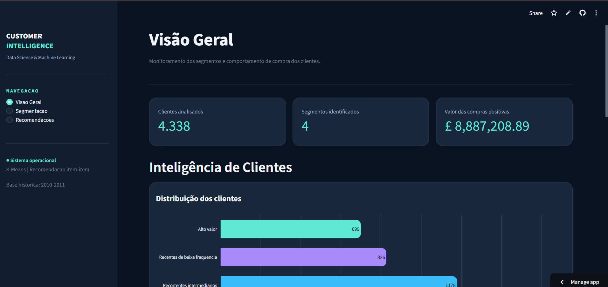
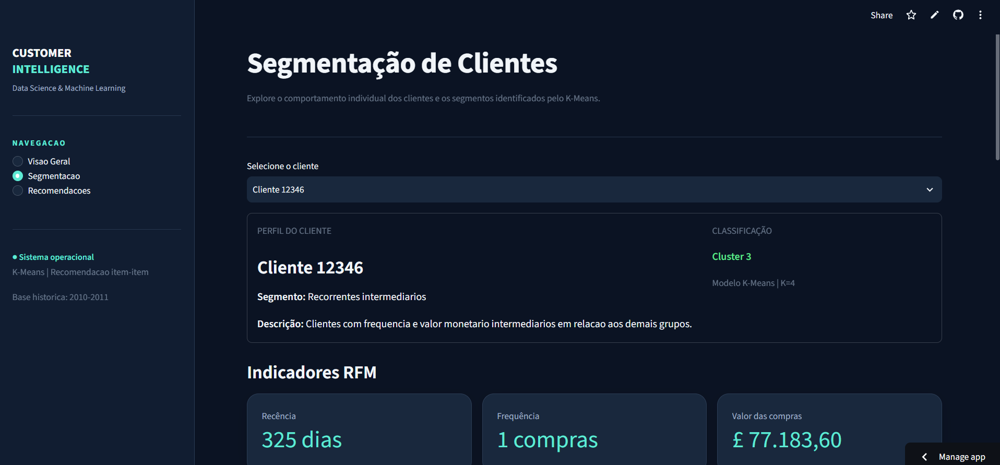
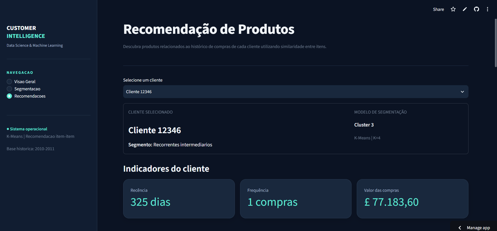

# Customer Intelligence — Dark Analytics Pro

**Segmentação RFM de clientes e recomendação personalizada de produtos com Machine Learning**

Aplicação interativa desenvolvida em **Python** e **Streamlit** para explorar o comportamento de consumidores, identificar segmentos com **K-Means** e recomendar produtos por **similaridade entre itens**. O projeto reúne análise exploratória, preparação automatizada de dados, avaliação de modelos, testes e uma interface web com identidade visual Dark Analytics Pro.

**[🚀 Acessar a aplicação online](https://customer-intelligence-kelvin.streamlit.app/)** · **[💻 Código-fonte](https://github.com/Kelvincbl/customer-intelligence)** · **[📂 Base de dados original (UCI)](https://archive.ics.uci.edu/dataset/352/online+retail)**

> **Nota:** projeto demonstrativo baseado em transações históricas de **dezembro de 2010 a dezembro de 2011**. Resultados e recomendações não representam comportamento atual de clientes nem desempenho em produção.

## Interface da aplicação

### Visão Geral



Apresenta indicadores gerais, distribuição dos clientes pelos quatro segmentos, participação no valor das compras positivas e tabela-resumo.

### Segmentação de Clientes



Permite selecionar um cliente pelo identificador, visualizar seus indicadores RFM e compará-los com a mediana do segmento atribuído.

### Recomendação de Produtos



Exibe o histórico de compras do cliente e cinco recomendações de produtos não adquiridos, acompanhadas de pontuações de similaridade.

> **Antes de publicar este README:** salve as três capturas de tela com os nomes acima na pasta `docs/images/`. Sem esses arquivos, as imagens aparecerão quebradas no GitHub.

## Resultados em destaque

| Indicador | Resultado |
|---|---:|
| Registros da base original | 541.909 |
| Linhas mantidas após limpeza | 392.692 |
| Clientes identificados e segmentados | 4.338 |
| Segmentos selecionados | 4 |
| Valor das compras positivas | £8.887.208,89 |
| Silhouette Score (K-Means, K=4) | 0,3322 |
| ARI médio entre inicializações (K=4) | 0,9821 |
| Precision@5 do recomendador | 0,0853 |
| Precision@5 do baseline de popularidade | 0,0443 |
| HitRate@5 do recomendador | 0,2842 |

Os valores financeiros representam **compras positivas**, sem descontar devoluções. Os 392.692 registros mantidos são **linhas de itens de transações**, não 392.692 pedidos independentes.

## Objetivos

- Examinar e tratar dados reais de vendas de comércio eletrônico.
- Construir indicadores de **Recency**, **Frequency** e **Monetary** (RFM).
- Identificar perfis de clientes por agrupamento não supervisionado.
- Produzir recomendações individualizadas a partir do histórico de compras.
- Comparar o recomendador com uma referência simples de popularidade em avaliação temporal.
- Disponibilizar resultados em uma aplicação web e organizar o projeto de forma reproduzível.

## Dados e preparação

A fonte utilizada é o conjunto **Online Retail**, disponibilizado pelo **UCI Machine Learning Repository**. Ele reúne vendas de uma empresa britânica de comércio eletrônico entre **01/12/2010 e 09/12/2011**.

O tratamento realizado abrangeu identificação de valores ausentes e duplicações, filtragem de registros sem identificador de cliente, separação de cancelamentos e exclusão de linhas com quantidade ou preço não positivos para o conjunto de compras utilizado na análise.

**Fonte e atribuição:** Chen, D. (2015). *Online Retail* [Dataset]. UCI Machine Learning Repository. DOI: [10.24432/C5BW33](https://doi.org/10.24432/C5BW33). Licença da fonte: **CC BY 4.0**.

## Segmentação RFM com K-Means

Para cada cliente, foram construídos os indicadores:

- **Recency:** dias desde a última compra na data de referência da análise.
- **Frequency:** quantidade de notas de compra distintas.
- **Monetary:** soma dos valores das compras positivas.

Antes do K-Means, as variáveis passaram por transformação `log1p` e padronização com `StandardScaler`. Foram comparados valores de **K entre 2 e 10**, considerando inércia e Silhouette Score. Embora **K=2** tenha apresentado maior Silhouette (0,4271), adotou-se **K=4** para oferecer perfis mais detalhados e interpretáveis, com Silhouette de **0,3322**.

| Segmento | Clientes | Participação |
|---|---:|---:|
| Alto valor | 699 | 16,11% |
| Inativos ou ocasionais | 1.635 | 37,69% |
| Recentes de baixa frequência | 826 | 19,04% |
| Recorrentes intermediários | 1.178 | 27,16% |

O segmento **Alto valor** concentra aproximadamente **64,5%** do valor das compras positivas da base tratada. A análise de estabilidade entre diferentes inicializações do K-Means com K=4 produziu **ARI médio de 0,9821**.

Os segmentos descrevem perfis típicos, não categorias definitivas. Clientes muito distintos da mediana do grupo podem exigir análise individual, especialmente quando apresentam valores monetários extremos.

## Sistema de recomendação

O recomendador utiliza uma matriz binária **cliente × produto** e **similaridade de cosseno entre itens**. Para cada cliente, combina pontuações de produtos associados ao seu histórico, retira aqueles já comprados e retorna os cinco itens mais bem pontuados.

### Avaliação temporal

Foi utilizada separação cronológica entre treinamento e teste, com **1.752 clientes elegíveis** na avaliação. O recomendador foi comparado com uma estratégia de **popularidade**.

| Métrica | Similaridade item-item | Popularidade |
|---|---:|---:|
| Precision@5 | **0,0853** | 0,0443 |
| Recall@5 | **0,0277** | 0,0104 |
| HitRate@5 | **0,2842** | 0,1838 |
| Cobertura do catálogo | **0,2234** | 0,0133 |

A Precision@5 foi aproximadamente **92,6% maior em termos relativos** do que a do baseline de popularidade, nesse protocolo de avaliação. As pontuações apresentadas na aplicação expressam **similaridade**, e não probabilidade de compra.

## Tecnologias

- **Python**, Pandas e NumPy — tratamento e exploração de dados.
- **Scikit-learn** e SciPy — aprendizado de máquina e operações com matrizes esparsas.
- **Plotly**, Matplotlib e Seaborn — visualização de dados.
- **Streamlit** — interface web multipáginas com tema personalizado.
- **Pytest** — testes automatizados.
- **Git e GitHub** — versionamento e publicação do código.

## Estrutura do repositório

```text
customer-intelligence/
├── .streamlit/
│   └── config.toml
├── app/
│   ├── main.py
│   ├── styles.py
│   ├── services/
│   └── views/
├── data/                 # arquivos locais ignorados pelo Git
│   ├── raw/
│   └── processed/
├── docs/
│   └── images/           # capturas da interface
├── models/
│   └── pipeline_kmeans.joblib
├── reports/
│   └── figures/
├── src/
│   ├── baixar_dados.py
│   ├── preparar_projeto.py
│   └── ...
├── tests/
│   └── test_customer_intelligence.py
├── .gitignore
├── README.md
└── requirements.txt
```

## Executar localmente

É recomendável utilizar uma versão de Python compatível com as dependências descritas em `requirements.txt` (a aplicação hospedada foi configurada para Python 3.12). Execute os comandos abaixo na raiz do projeto.

**1. Clonar e entrar no projeto**

```bash
git clone https://github.com/Kelvincbl/customer-intelligence.git
cd customer-intelligence
```

**2. Criar ambiente virtual e instalar dependências**

Windows (PowerShell):

```powershell
python -m venv .venv
.\.venv\Scripts\Activate.ps1
python -m pip install -r requirements.txt
```

Linux/macOS:

```bash
python3 -m venv .venv
source .venv/bin/activate
python -m pip install -r requirements.txt
```

**3. Preparar a base e os modelos**

```bash
python src/preparar_projeto.py
```

O pipeline verifica a presença da planilha original em `data/raw/`, tenta baixá-la da UCI se necessário, realiza a limpeza, gera indicadores RFM e salva o modelo e os arquivos processados. A primeira execução requer conexão com a internet e pode levar mais tempo.

**4. Iniciar o aplicativo**

```bash
python -m streamlit run app/main.py
```

**5. Executar os testes**

```bash
python -m pytest tests/ -v
```

Os arquivos em `data/raw/` e `data/processed/` não são versionados. O aplicativo também tenta preparar os dados automaticamente quando seus arquivos processados necessários não estão presentes.

## Limitações e próximos aprimoramentos

- Os dados abrangem apenas um negócio e um período histórico específico.
- O valor monetário utiliza compras positivas e não desconta devoluções.
- Perfis de agrupamento podem ser sensíveis a clientes com gastos extremos.
- As métricas do recomendador dependem do corte temporal, do catálogo e dos clientes elegíveis.
- Ainda são possíveis melhorias na avaliação de estabilidade temporal dos segmentos, na comparação com outros recomendadores e na instalação reproduzível das dependências.

## Autor

**William Kelvin** — Projeto de portfólio em Ciência de Dados.

- **[Aplicação online](https://customer-intelligence-kelvin.streamlit.app/)**
- **[GitHub](https://github.com/Kelvincbl/customer-intelligence)**

---

*Projeto educacional e demonstrativo. Nenhuma das recomendações constitui decisão comercial validada em produção.*
